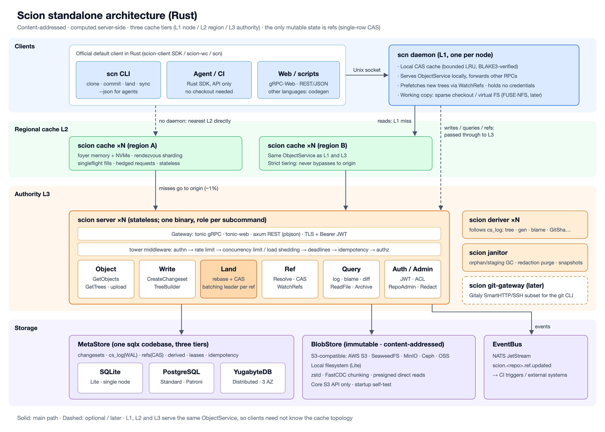

# Scion

[English](README.md) | 简体中文

服务端优先的源码管理系统：历史、合并、rebase 都在服务端完成，客户端始终在线、按需取数。协议与语言无关，官方提供 Rust 服务端 `scion` 和 Rust 客户端 `scn`。



<sub>架构图源文件：[`arch-01-standalone.en.svg`](docs/design/images/arch-01-standalone.en.svg)（英文）· [`arch-01-standalone.svg`](docs/design/images/arch-01-standalone.svg)（中文）。图中包含规划中的组件（L2 缓存、deriver、git-gateway 等），当前进度见下文。</sub>

## 文档

**使用指南**
- [从 git 导入](docs/guide/git-import.md)：把已有的 git 仓库连同全部历史导入 Scion

**设计与规范**
- 设计文档：[服务端](docs/design/rust-server-architecture.md) · [客户端](docs/design/rust-client-architecture.md) · [接入 starhub / CSGLite](docs/design/starhub-integration.md)
- 对象格式规范：[`SPEC.md`](SPEC.md)，golden 测试向量在 [`testdata/vectors/`](testdata/vectors/)
- 协议：[`proto/scion/v1/`](proto/scion/v1/)

当前进度：**M1 最小闭环**已完成（写入路径、Lite 模式、`scn` 工作副本、git 导入）。下一步 M2：派生数据与查询（log / blame / diff）。

## 目录结构

```
proto/scion/v1/      协议定义（.proto），语言无关，buf lint / breaking 检查
SPEC.md              对象模型与规范编码
testdata/vectors/    golden 测试向量，任何语言的实现都应通过

common/              服务端和客户端共用（只能依赖 common）
  protocol/          scion-proto   由 proto 生成的 Rust 代码
  object/            scion-object  ObjectId、规范编码、Tree / Changeset（纯计算，无 IO）

server/              服务端（可依赖 common 与更低层的 server crate）
  store/             scion-store       MetaStore / BlobStore trait、内存实现、后端一致性测试套件
  store-sql/         scion-store-sql   SQLite / PostgreSQL 元数据存储
  store-blob/        scion-store-blob  本地目录 / S3 兼容对象存储
  tree/              scion-tree        增量建树
  api/               scion-api         gRPC 服务实现与启动入口
  scion/             scion             服务端二进制（scion server --lite / --meta / --blobs）

client/              客户端（只能依赖 common 与 client，禁止依赖 server）
  sdk/               scion-client  Rust SDK
  wc/                scion-wc      工作副本（clone / status / commit / land / sync）
  gitimport/         scion-gitimport  git 历史导入
  cli/               scion-cli     命令行二进制 scn

xtask/               仓库维护任务（cargo xtask layers：依赖方向检查）
deploy/dev/          本地开发依赖（SeaweedFS、PostgreSQL）
docs/guide/          使用指南
docs/design/         设计文档与架构图
```

目录名表示位置和职责；crate 名统一带 `scion-` 前缀，避免与 crates.io 上的同名库（如 `object`）冲突。依赖方向由 `cargo xtask layers` 在 CI 中强制检查。

## 快速开始

```sh
# 启动服务端（Lite 档：SQLite + 本地目录，数据落盘），预建仓库 mono
cargo run -p scion -- server --lite --data-dir ./.scion-data --repo mono

# 其它后端：--meta mem|sqlite://PATH|postgres://…  --blobs mem|DIR|s3://bucket/prefix
# S3 连接参数：SCION_S3_ENDPOINT、SCION_S3_ACCESS_KEY_ID、SCION_S3_SECRET_ACCESS_KEY、SCION_S3_REGION

# 另一个终端：安装 scn 并检查连接
cargo install --path client/cli
scn doctor

# 日常流程
scn clone mono && cd mono          # 检出（默认 ref main，空仓库也可以）
echo 'hello' > README.md
scn status                          # A README.md
scn commit -m "add readme" --author "Ada <ada@example.com>"
scn land                            # 快进合入 main
scn sync                            # 拉取别人合入的改动；有未合入的提交时自动做文件级 rebase
scn cat main:README.md              # 不需要工作副本也能读文件（工作副本外加 --repo）
scn ls main:                        # 列目录；所有命令都支持 --json
scn log --path src -n 10            # 历史，从新到旧，可按路径过滤
scn diff                            # 本地未提交的改动（unified diff）
scn diff main                       # main 最新提交引入的改动；`scn diff A B` 比较两个版本
scn blame src/lib.rs                # 每一行最后被哪个提交改动

# 导入已有的 git 仓库（保留全部历史、作者与时间），详见 docs/guide/git-import.md
scn import git ~/src/my-repo --repo mono
```

## 开发

```sh
cargo test --workspace                          # 全部测试
cargo clippy --workspace --all-targets -- -D warnings
cargo xtask layers                              # 依赖方向检查
cargo llvm-cov --workspace                      # 覆盖率（需 cargo install cargo-llvm-cov）
SCION_BLESS=1 cargo test -p scion-object --test vectors   # 新增 golden 向量后重新生成
docker compose -f deploy/dev/docker-compose.yml up -d     # SeaweedFS（S3）+ PostgreSQL
```

**测试要求**（[服务端设计文档 §12.1](docs/design/rust-server-architecture.md)）：每个含逻辑的函数都要有单元测试，覆盖正常路径、边界条件和每一个错误分支。核心 crate 行覆盖率不低于 90%，PR 新增代码不低于 90%，由 CI 强制执行。

## 许可证

Apache-2.0
